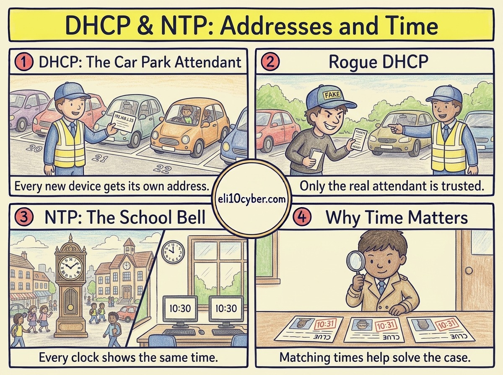

Tap the poster to zoom in.

Like you’re 10

**DHCP is the car park attendant.** When a car drives in, the attendant gives it a ticket with its own **numbered space**, and a note saying how long it can stay. Nobody has to argue over spaces, and when a car leaves, its space goes back to the pile for the next car.

**NTP is the school bell.** One master clock tells every classroom clock the exact time, so the whole school agrees when lessons start and end. If one clock was ten minutes fast, nobody could work out who was really late.

Grown-up version

**DHCP (Dynamic Host Configuration Protocol)** automatically gives a device an **IP address lease** and its network settings: subnet mask, **default gateway** and **DNS servers**. The exchange has four steps, often remembered as **DORA**: Discover, Offer, Request, Acknowledge. It runs on UDP 67 and 68.

**NTP (Network Time Protocol)** synchronises clocks to a trusted reference source, arranged in levels called *strata* (stratum 0 is an atomic or GPS clock). It runs on UDP 123.

**Attacks to know:**

| Attack | What happens | Defence |
|---|---|---|
| **Rogue DHCP server** | A fake server hands out settings that route victims through the attacker | DHCP snooping on switches |
| **DHCP starvation** | An attacker requests every address until none are left | Port security, limits per port |
| **NTP amplification** | Attackers use badly configured NTP servers to flood a victim with traffic (a type of DDoS) | Disable unneeded NTP features, filter traffic |
| **Time tampering** | Wrong clocks break logins and make logs useless as evidence | Authenticated time sources, monitoring for drift |

## A real-world example

When an incident happens, investigators line up logs from firewalls, servers, laptops and cloud services to rebuild what the attacker did, minute by minute. If one system’s clock was out by even a few minutes, the story falls apart. That’s why payment card rules (PCI DSS) explicitly require time synchronisation.

Why a buyer cares

- **The risk it reduces:** attackers hijacking traffic through fake network settings, and investigations that collapse because timestamps don’t agree.
- **Who owns it at a company:** the network or infrastructure team. The security operations team depends on the clocks being right.
- **What gets bought:** **DDI** platforms that manage DNS, DHCP and IP addresses together, and network switches with security features such as DHCP snooping.
- **A good discovery question:** *“If you had to rebuild the timeline of an incident across your firewalls, servers and cloud logs tomorrow, would the timestamps agree?”*

## The one thing to remember

DHCP hands out addresses, NTP hands out the time. Both are boring until an attacker fakes them.
