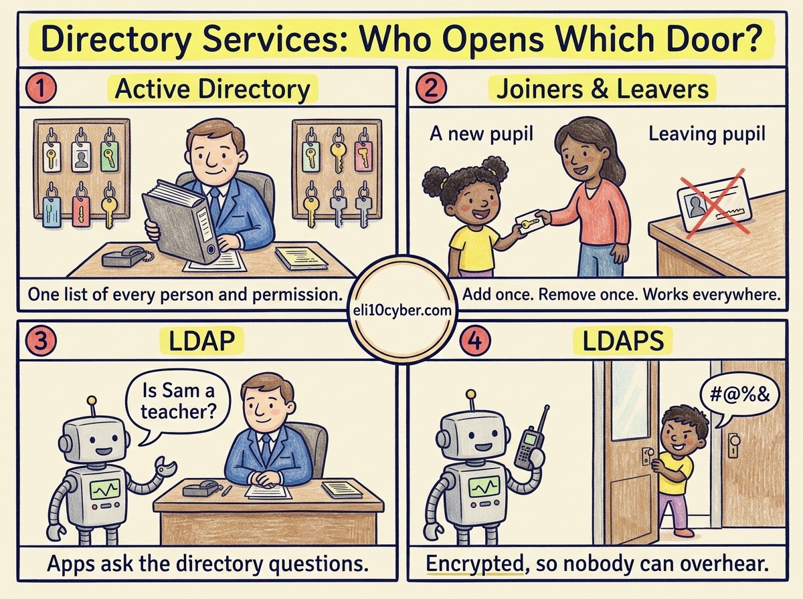

Tap any panel to explore it.

Like you’re 10

Imagine the **head teacher’s big binder**. It lists every pupil and teacher, which class they’re in, and exactly **which doors their key card opens**. When someone joins, they’re added once, and their card works everywhere it should. When someone leaves, they’re crossed out once, and every door locks them out.

That binder is a **directory**. In most companies it’s Microsoft’s **Active Directory**.

**LDAP is the polite way to ask the binder a question**, like “Is this person a teacher?” without being allowed to flick through the whole book.

**LDAPS is asking that question in a whisper** through a scrambled walkie-talkie, so a nosy kid in the corridor can’t overhear the answer, or anyone’s password.

Grown-up version

A **directory service** is a central database of identities and resources (users, groups, computers, printers) and the rules about who can access what.

| | What it is | Port |
|---|---|---|
| **AD DS** (Active Directory Domain Services) | Microsoft’s directory for Windows networks. Runs on **domain controllers**, applies settings through **Group Policy**, and authenticates users mainly with **Kerberos** | Kerberos TCP/UDP 88 |
| **LDAP** (Lightweight Directory Access Protocol) | The standard protocol for querying and updating a directory. Apps use it to check who a user is and which groups they belong to | TCP 389 |
| **LDAPS** (LDAP over TLS) | LDAP inside an encrypted TLS connection | TCP 636 |

**Main use cases:**

- **Central authentication:** one account per person, used to sign in to computers, email and many apps.
- **Access control:** permissions assigned to groups (“Finance”, “HR”), so access follows the role, not the individual.
- **Fast joiners and leavers:** disable one account and access to everything tied to it stops.

**Security points for the exam:**

- **Plain LDAP sends data unencrypted.** A simple LDAP sign-in can expose passwords to anyone listening. Use LDAPS (or LDAP upgraded with StartTLS).
- **LDAP injection** is an application attack where crafted input changes a directory query, much like SQL injection.
- **Kerberos needs synchronised clocks**, so if time drifts too far (5 minutes by default), sign-ins fail. That’s the link back to NTP.

## A real-world example

In 2017, the NotPetya malware wiped computers at the shipping giant Maersk worldwide, including its domain controllers, the servers holding Active Directory. Without them, nobody could log in to anything. Recovery hinged on one domain controller in Ghana that happened to be offline during the attack because of a power cut. Its hard drive was flown to the UK, and the company’s whole identity system was rebuilt from it.

Why a buyer cares

- **The risk it reduces:** many serious attacks, ransomware included, rely on stealing or abusing accounts. Taking over Active Directory gives an attacker the whole company at once.
- **Pressure:** cyber insurers and auditors ask about privileged accounts, MFA and joiner/leaver controls. Weak answers raise premiums or block cover.
- **Who owns it at a company:** IT infrastructure runs it, while the CISO and the identity and access management (IAM) team own the risk. It’s a board-level topic after any ransomware story.
- **What gets bought:** identity platforms (Microsoft Entra ID, Okta), **identity threat detection and response** (CrowdStrike, Microsoft Defender for Identity), Active Directory backup and recovery (Semperis, Quest), and privileged access management.
- **A good discovery question:** *“If your Active Directory was encrypted tonight, how long would it take to get everyone logging in again?”*

## The one thing to remember

AD DS is the master binder, LDAP is how apps ask it questions, and LDAPS keeps those questions private. Protect the binder above everything else.
