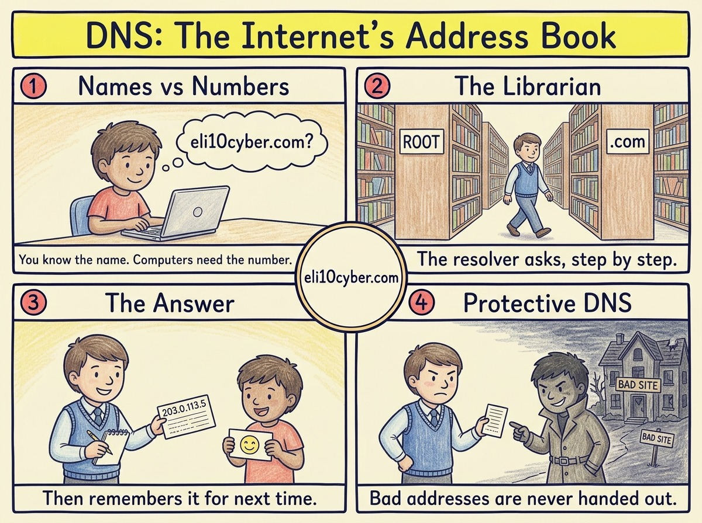

Tap the poster to zoom in.

Like you’re 10

You know your friend’s name, but to send them a letter you need their **house number**. Computers are the same: you type a name like `eli10cyber.com`, but to connect, your computer needs a number (an IP address).

**DNS is the internet’s address book.** Your computer asks, “Where does eli10cyber.com live?” and DNS answers with the number.

There isn’t one giant book. It’s more like a library: the **librarian** (called a resolver) asks the main desk where the `.com` books are, then asks the `.com` shelf where `eli10cyber.com` is, then writes the answer down so next time it can **remember it instantly**.

Grown-up version

**DNS (Domain Name System)** is a distributed, hierarchical database that maps domain names to IP addresses and other information. A **recursive resolver** answers your query by asking, in turn, the **root** servers, the **top-level domain** servers (like `.com`) and the domain’s **authoritative** servers. It then **caches** the answer for as long as the record’s time-to-live (TTL) allows.

**Record types to know:**

| Record | Purpose |
|---|---|
| **A** | Name to IPv4 address |
| **AAAA** | Name to IPv6 address |
| **CNAME** | Alias from one name to another |
| **MX** | Where to deliver email for the domain |
| **TXT** | Free text, used for email security (SPF, DKIM, DMARC) and proving domain ownership |
| **NS** | Which servers are authoritative for the domain |

**Attacks to know:** **DNS spoofing and cache poisoning** (forged answers, fixed by DNSSEC), **domain hijacking** (taking over the domain’s registrar account), **DNS tunnelling** (smuggling data out inside DNS queries), and **DDoS** against DNS providers.

**Privacy:** plain DNS is unencrypted on port 53, so anyone on the network can see which sites you look up. **DNS over HTTPS (DoH)** and **DNS over TLS (DoT)** encrypt the lookups.

## A real-world example

In October 2016, a botnet of hacked cameras and home routers flooded the DNS provider Dyn with traffic. Dyn’s servers couldn’t answer, so for hours millions of people couldn’t reach major sites like Twitter, Netflix and Reddit, even though those sites were running perfectly. Nobody could look up their addresses.

Why a buyer cares

- **The risk it reduces:** almost all malware has to look up a domain to phone home, and almost every phishing link needs a lookup to load. Blocking bad lookups stops attacks very early. DNS outages also take a company offline.
- **Who owns it at a company:** the network team runs it. Security teams increasingly use it as a control.
- **What gets bought:** **protective DNS** that blocks malicious domains (Cisco Umbrella, Cloudflare Gateway, Infoblox, Akamai). In the UK, the NCSC runs a protective DNS service for the public sector. Also **managed DNS** for resilience, and **DDI** platforms.
- **A good discovery question:** *“If a laptop on your network tried to reach a known malware domain right now, what would stop it?”*

## The one thing to remember

DNS turns names into numbers. Because every connection starts with it, it’s both a single point of failure and one of the best places to block attacks.
