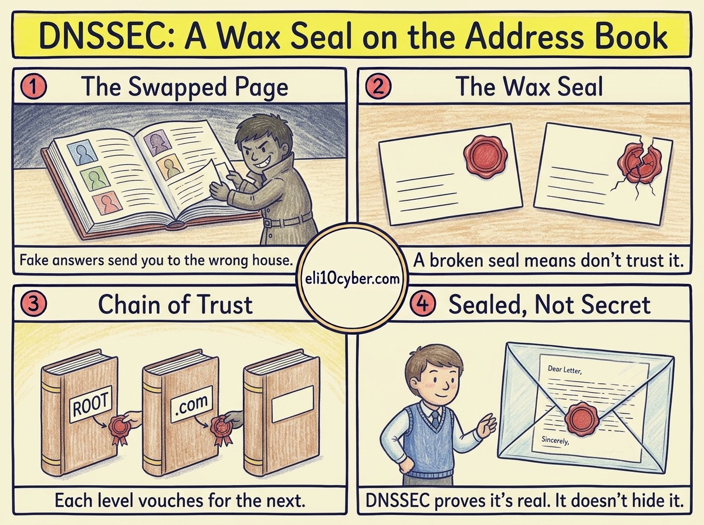

Tap the poster to zoom in.

Like you’re 10

The internet has a giant **address book** called DNS. When you type `eli10cyber.com`, your computer asks the address book, “Where does this website live?” and gets back a house number (an IP address).

But what if a sneaky person **swapped the page** in the address book? You’d go to *their* house instead, and it might look exactly like the real one.

**DNSSEC adds a wax seal** to every answer. Only the real owner can make that seal, but anyone can check it. If the seal is broken or missing, your computer says “Nope, that’s not trustworthy” and refuses the fake address.

And who vouches that the seal itself is real? The **parent** book does. The `.com` book says “this is the real seal for eli10cyber.com”, and the **root** book at the very top says “this is the real seal for `.com`”. Everyone checks the chain all the way up.

The chain of trust: each level vouches for the seal below it. Tap to enlarge.

Grown-up version

**DNS Security Extensions (DNSSEC)** add cryptographic signatures to DNS data so that a **validating resolver** can confirm two things: the answer came from the authoritative source (*authenticity*), and it wasn’t altered in transit (*integrity*).

The key record types:

| Record | What it does | In the kid version |
|---|---|---|
| **RRSIG** | The digital signature over a set of DNS records | The wax seal |
| **DNSKEY** | The zone’s public keys, used to check signatures | The stamp pattern everyone can compare against |
| **DS** | A hash of the child zone’s key, stored in the **parent** zone | The parent vouching for the child’s seal |
| **NSEC / NSEC3** | Signed proof that a name *doesn’t* exist | A sealed note saying “no such page” |

This creates a **chain of trust** from the root zone (signed since 2010), through the top-level domain (`.com`), down to your domain. If any link fails to validate, the resolver treats the answer as bogus and the lookup fails.

**What DNSSEC does *not* do** (a classic exam trap):

- It does **not encrypt** DNS. Lookups are still visible. For privacy, you need DNS over HTTPS (DoH) or DNS over TLS (DoT).
- It does **not** stop DDoS attacks on DNS servers.
- It does **not** protect you if the attacker controls your registrar account. They could simply change the real records. That’s why registrar accounts need strong MFA.

**Why it exists:** in 2008, researcher Dan Kaminsky showed how easily attackers could poison resolver caches at scale. DNSSEC is the long-term fix for that class of attack.

## What I did on my own site

When I registered `eli10cyber.com` on Cloudflare, turning DNSSEC on took one click in the domain’s settings. Cloudflare then sent the DS record up to the `.com` registry for me. Anyone can check it: look the domain up on [lookup.icann.org](https://lookup.icann.org/) and the DNSSEC field shows **signedDelegation**.

So this very website is protected by the thing this lesson is about.

Why a buyer cares

- **The risk it reduces:** customers being silently redirected to a fake site, which leads to credential theft, payment fraud and brand damage. For banks, retailers and government services, that’s a board-level worry.
- **Who owns it at a company:** usually the network or infrastructure team (often called the DNS or “DDI” team), with input from security. Domain registration itself sometimes sits with legal or marketing, which is how important domains get forgotten.
- **What gets bought:** DNSSEC itself is rarely sold on its own. It’s a feature inside bigger purchases: **managed DNS** (Cloudflare, Akamai, AWS Route 53, Azure DNS), **DDI platforms** that combine DNS, DHCP and IP management (Infoblox, BlueCat, EfficientIP), and **enterprise registrars** with domain-locking and brand protection.
- **Compliance angle:** US federal agencies have been required to sign their `.gov` domains with DNSSEC since 2008, and it appears in many security baselines.

**A good discovery question if you sell in this space:** *“If someone hijacked DNS for your main customer login domain this afternoon, how quickly would you know, and who would get the call?”*

## The one thing to remember

DNSSEC answers **“Is this address real?”**, not **“Can anyone see what I looked up?”** Integrity, not confidentiality.
