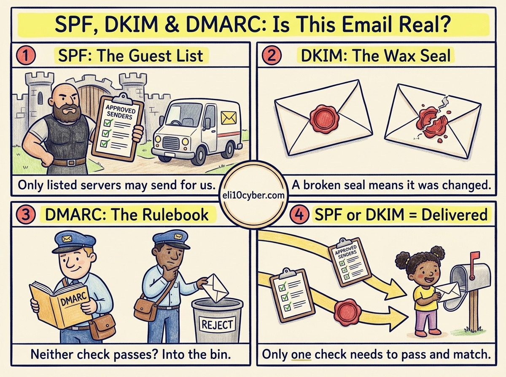

Tap any panel to explore it.

Like you’re 10

Imagine getting a letter that says it’s from your favourite football club, but it’s really from a trickster after your pocket money. Anyone can write any name on an envelope, and email works the same way. So the internet uses **three helpers**:

**SPF is the guest list.** The club publishes a list of the only post offices allowed to send its letters. If a letter arrives from a post office that isn’t on the list, something is fishy.

**DKIM is the wax seal.** Every real letter gets a special seal that only the club can make. If someone opens the letter and changes it on the way, the seal won’t match.

**DMARC is the club’s rulebook for your postman.** It says: “If a letter claiming to be from us has **neither** the right post office **nor** a matching seal, put it in the bin.” It also asks the postman to send the club a report about the fakes.

Grown-up version

All three are published as **TXT records in the sending domain’s DNS**.

| | What it checks | Published at |
|---|---|---|
| **SPF** (Sender Policy Framework) | Is the sending server’s IP address authorised to send for this domain? | `yourdomain` TXT `v=spf1 …` |
| **DKIM** (DomainKeys Identified Mail) | Does the signature in the header verify against the domain’s public key, proving the content wasn’t altered? | `selector._domainkey.yourdomain` |
| **DMARC** (Domain-based Message Authentication, Reporting and Conformance) | Did SPF or DKIM pass for a domain that **aligns** with the visible From address? What should happen if not? | `_dmarc.yourdomain` |

**The exam trap:** DMARC does **not** fail an email just because one check fails. An email **passes DMARC if either SPF or DKIM passes and aligns** with the From domain. It fails only when both do.

**Why alignment matters:** SPF on its own checks a hidden “envelope” sender address, not the From address people see. A scammer can pass SPF for their own domain while showing your company’s name. DMARC closes that gap by requiring the checked domain to match the visible one.

**DMARC policies:** `p=none` (monitor only), `p=quarantine` (spam folder), `p=reject` (refuse). Companies usually start at `none`, read the reports to find all their legitimate senders, then tighten to `reject`.

**What they don’t do:** none of them encrypt email, and none stop a scammer using a lookalike domain such as `paypa1.com`. They only protect the exact domain that publishes them.

## Try it yourself

You can look up any company’s DMARC policy from a terminal. On Mac or Linux, type `dig TXT _dmarc.bbc.co.uk +short`. On Windows, type `nslookup -type=TXT _dmarc.bbc.co.uk`. Swap in your bank or employer’s domain and look at the `p=` value: `reject` means fakes are refused, `none` means they’re only being watched.

Why a buyer cares

- **The risk it reduces:** **business email compromise**, where criminals pose as a CEO or supplier to get payments redirected. It is consistently one of the costliest cybercrimes reported to the FBI. Spoofed emails also damage a brand’s reputation with its customers.
- **Pressure:** since 2024, Google and Yahoo require SPF, DKIM and DMARC from anyone sending email in bulk, and Microsoft followed for Outlook in 2025. Without them, marketing emails get rejected. In the UK, the NCSC’s Mail Check helps public bodies enforce DMARC.
- **Who owns it at a company:** IT or security, but marketing often feels the pain first, because their email platform is one of the senders that must be authorised.
- **What gets bought:** DMARC management services (Valimail, dmarcian, Red Sift), and email security gateways (Proofpoint, Mimecast) that use these checks alongside phishing detection.
- **A good discovery question:** *“Is your domain’s DMARC policy at reject yet, and do you know every service that sends email in your name?”*

## The one thing to remember

SPF checks **who** sent it, DKIM checks it **wasn’t changed**, and DMARC decides **what happens** when neither check passes.
