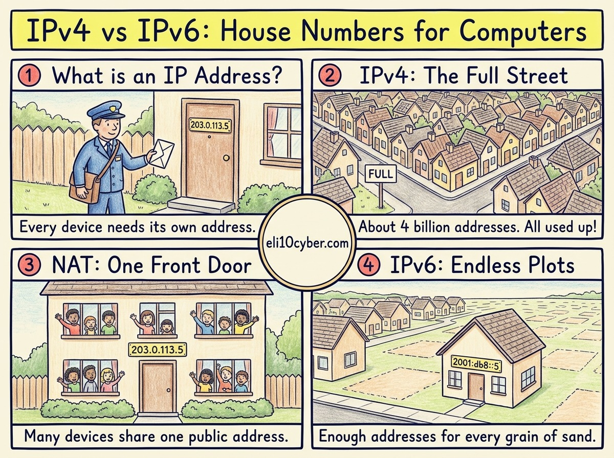

Tap any panel to explore it.

Like you’re 10

Every house on your street has a **number** so the postman knows where to deliver. Every computer, phone and smart TV on the internet needs a number too. That number is its **IP address**.

The old numbering system, **IPv4**, was invented when only a few big computers were online. It had room for about four billion numbers. That sounded like plenty, until everyone got a phone, a tablet, a games console and a smart doorbell. **The numbers ran out.**

So engineers built **IPv6**, a new system with numbers so long that every grain of sand on Earth could have its own address, with plenty left over.

Grown-up version

An **IP address** identifies a device’s network interface so packets can be routed to it.

| | IPv4 | IPv6 |
|---|---|---|
| Length | 32 bits | 128 bits |
| Written as | Four decimal numbers, `203.0.113.5` | Eight hex groups, `2001:db8::5` |
| How many | About 4.3 billion | About 3.4 × 10³⁸ |
| Getting an address | Manually or via DHCP | Manually, DHCPv6, or the device builds its own (SLAAC) |
| Private ranges | `10.x`, `172.16–31.x`, `192.168.x` | Unique local addresses (`fd00::/8`) |

**Why IPv4 survived so long:** **NAT** (Network Address Translation) lets a whole office or home share one public IPv4 address. The global pool of free IPv4 addresses still ran dry: the central registry handed out its last blocks in 2011, and Europe’s registry ran out in 2019. Today, spare IPv4 addresses are bought and sold.

**Security points worth knowing for the exam:**

- **NAT is not a firewall.** It hides internal addresses, but it is not a security control by itself.
- **Dual stack** means a network runs IPv4 and IPv6 side by side. Firewall rules, monitoring and logging must cover both, or IPv6 becomes an unwatched side door.
- IPv6 did originally make **IPsec** support mandatory, but using it was never required. Don’t assume IPv6 traffic is encrypted.

## A real-world example

The device you’re reading this on almost certainly has both an IPv4 and an IPv6 address right now. Many mobile networks now run mainly on IPv6, and translate to IPv4 only when a website still needs it.

Why a buyer cares

- **The risk it reduces:** blind spots. An organisation that monitors only IPv4 can miss attackers using IPv6, and messy address records slow down every investigation.
- **Who owns it at a company:** the network team. Security cares when an incident needs to trace “which device had this address at 2am?”
- **What gets bought:** IP address management, usually inside **DDI** platforms (DNS, DHCP and IP address management combined), and firewalls that inspect both IPv4 and IPv6.
- **A good discovery question:** *“Do your firewall rules and monitoring cover IPv6 as thoroughly as IPv4, or is it switched on and unwatched?”*

## The one thing to remember

IPv4 is a short house number that ran out. IPv6 is a very long one that won’t. Both must be watched.
