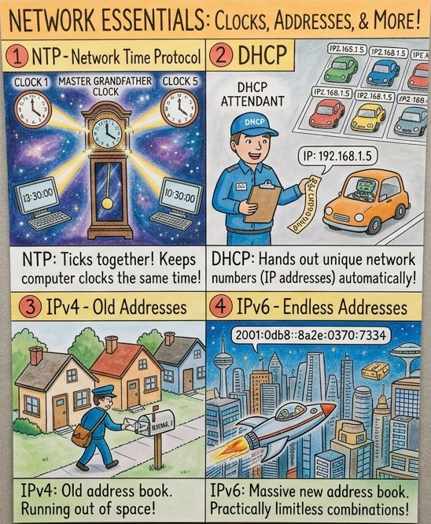
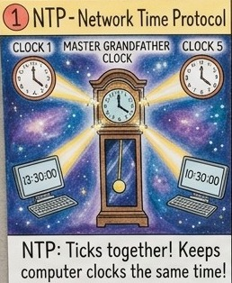
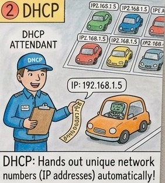
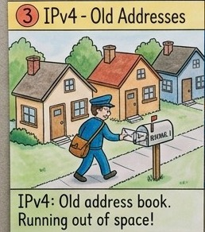

The whole set on one page. Tap it to see it full size.

Network essentials in four panels. Draft illustration: some labels still need fixing.

## The four ideas, one at a time

Like you’re 10

**NTP** is the school bell. One master clock tells every other clock the time, so everyone agrees when lunch starts.

**DHCP** is the car park attendant. Every car that arrives gets **its own numbered space** and a ticket saying how long it can stay.

**IPv4** is the old street address book. It has room for about four billion houses, and the world has already **run out of pages**.

**IPv6** is the new address book. It has so many pages that every grain of sand could have its own address.

Grown-up version

| Protocol | What it does | Security angle |
|---|---|---|
| **NTP** | Synchronises device clocks to a reference time source | Accurate timestamps for logs and forensics; Kerberos rejects requests when clocks drift too far |
| **DHCP** | Assigns IP address, gateway and DNS settings automatically, for a lease period | Rogue DHCP servers and starvation attacks; mitigated by DHCP snooping on switches |
| **IPv4** | 32-bit addresses, written like `192.168.1.5` | Address shortage led to NAT, which hides internal devices but complicates tracing |
| **IPv6** | 128-bit addresses, written like `2001:db8::8a2e:370:7334` | Often enabled by default but not monitored, creating blind spots |

Why a buyer cares

- **The risk it reduces:** investigations that stall because logs can’t be lined up, and attackers hijacking traffic through fake network settings.
- **Who owns it at a company:** the network team, with the security operations team relying on the timestamps.
- **What gets bought:** DDI platforms that manage DNS, DHCP and IP addresses together, network access control, and SIEM tools that depend on accurate time.
- **A good discovery question:** *“If you had to rebuild the timeline of an incident across your firewalls, servers and cloud logs tomorrow, would the timestamps agree?”*

