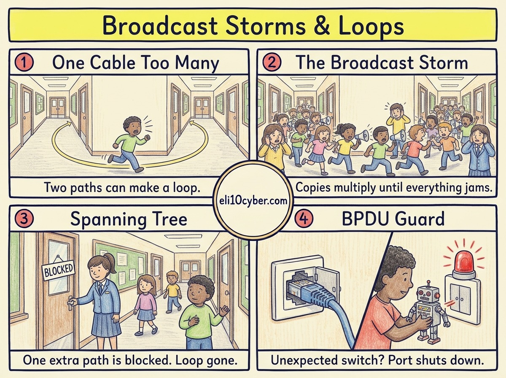

Tap any panel to explore it.

Like you’re 10

Imagine two school corridors that join up into a **circle**. A pupil runs down one, shouting a message, and comes out the other end. Someone hears it and shouts it again. Soon there are dozens of pupils running round and round, all shouting, and **nobody can hear anything else**. That’s a **broadcast storm**.

The fix is the **caretaker**. Every morning the caretakers on each floor pass **notes** to each other to draw a map of the corridors. If they spot a circle, they **lock one door**, so there’s only ever one way round. If the main corridor gets blocked, they unlock the spare door.

Those notes are called **BPDUs**. And if a pupil sneaks in their own toy caretaker, **BPDU guard** spots the fake notes and locks that classroom door straight away.

Grown-up version

**Switching loops** happen when there is more than one path between switches, often added on purpose for resilience, or by accident when someone connects two wall sockets with one cable.

**Why loops are so destructive:** a switch sends broadcasts out of every port. In a loop they come back and get sent out again, multiplying each time. Unlike IP packets, **Ethernet frames have no time-to-live**, so they never expire. Within seconds the **broadcast storm** uses all the bandwidth and the switches’ processing power, and the network freezes.

**Loop prevention:**

| Tool | What it does |
|---|---|
| **STP** (Spanning Tree Protocol, IEEE 802.1D) | Switches elect a root switch and block redundant ports so only one active path remains. Blocked links take over if the active one fails |
| **RSTP** (Rapid STP, 802.1w) | The same idea, recovering in seconds instead of up to about a minute |
| **BPDU** (Bridge Protocol Data Unit) | The messages switches exchange to build the spanning tree |
| **BPDU guard** | Shuts down (err-disables) an edge port if a BPDU arrives, because a PC should never send one |
| **Root guard** | Stops a newly connected switch taking over as the root |

**The security angle:** an attacker who plugs in a switch, or software pretending to be one, can send BPDUs to become the root and pull traffic through their device, or simply crash the network. BPDU guard on every user-facing port stops both.

## A real-world example

In November 2002, Beth Israel Deaconess Medical Center in Boston lost its network for about four days. Investigators traced the meltdown to spanning tree failures on a network that had grown too large and flat. Staff went back to paper records and runners carrying messages between departments, and the hospital rebuilt its network design afterwards.

Why a buyer cares

- **The risk it reduces:** sudden network-wide outages, from an accidental cable or a deliberate attack, that stop every system at once.
- **Who owns it at a company:** the network team. It rarely reaches the security budget until something breaks.
- **What gets bought:** nothing separately. Loop prevention is built into business switches. The spend shows up in network design work and in monitoring that spots a storm early.
- **A good discovery question:** *“If someone looped a cable between two meeting room sockets, how quickly would the network recover, and who would find out first?”*

## The one thing to remember

Loops make broadcasts multiply forever. Spanning tree blocks the extra path, BPDUs are the messages it uses, and BPDU guard shuts out anyone faking them.
