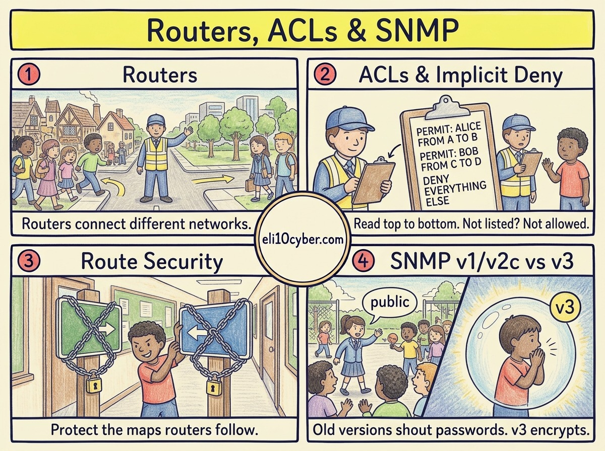

Tap any panel to explore it.

Like you’re 10

Your school is one neighbourhood and the park is another. A **router** is the **crossroads guard** between neighbourhoods, sending each traveller down the right road.

The guard carries a **clipboard of rules**, read from the top: “Pupils with a permission slip may go to the park. Parents may come in.” That clipboard is an **ACL**. And the most important rule is the invisible one at the bottom: **“Not on the list? Not getting through.”** That’s **implicit deny**.

**Route security** stops pranksters from **swapping the road signs** so everyone ends up in the wrong place.

**SNMP** is how the head office checks on every guard: “Are you OK? How busy are you?” Old versions did it by **shouting the password across the playground**. Version 3 **whispers inside a secret bubble**.

Grown-up version

A **router** forwards packets between different networks using a **routing table**. It is also a natural place to filter traffic.

**ACLs (access control lists)** permit or deny traffic based on source and destination IP address, protocol and port. Three rules to remember for the exam:

1. Rules are processed **top to bottom**, and the **first match wins**, so order matters.
2. Every ACL ends with an invisible **implicit deny**: anything not explicitly allowed is blocked.
3. Put the most specific rules first, and review rules regularly so old permissions don’t pile up.

**Route security:** routers learn routes from each other using routing protocols such as **OSPF** inside a company and **BGP** between internet providers. Attackers or mistakes can inject false routes. Defences include **authentication between routers**, filtering which routes are accepted, and for BGP, **RPKI**, which lets networks check that an announcement comes from the real owner of those addresses.

**SNMP (Simple Network Management Protocol)** lets monitoring tools read device health and receive alerts.

| Version | Security |
|---|---|
| **SNMPv1, v2c** | Plain-text **community strings**, often left as the defaults `public` and `private` |
| **SNMPv3** | Per-user **authentication** and **encryption**. The only version to use |

## A real-world example

In February 2008, Pakistan’s government ordered YouTube blocked inside the country. Pakistan Telecom did it by announcing a route claiming to be YouTube, but the announcement leaked to the rest of the internet through BGP. For around two hours, much of the world’s YouTube traffic was sent to Pakistan and dropped.

Why a buyer cares

- **The risk it reduces:** attackers moving freely between networks, traffic being hijacked, and network devices being taken over through weak management protocols.
- **Pressure:** payment card rules (PCI DSS) require network security controls between trusted and untrusted networks, with rule sets reviewed regularly. Auditors ask to see them.
- **Who owns it at a company:** the network team runs it. The security team owns firewall policy.
- **What gets bought:** **firewalls** (Palo Alto Networks, Fortinet, Cisco, Check Point), **firewall policy management** tools to tidy years of old rules, and **network monitoring** that uses SNMPv3.
- **A good discovery question:** *“When did someone last review your firewall rules, and how many are still there that nobody can explain?”*

## The one thing to remember

Routers connect networks. ACLs are read top to bottom with an invisible deny-everything at the end. Use SNMPv3, never v1 or v2c.
