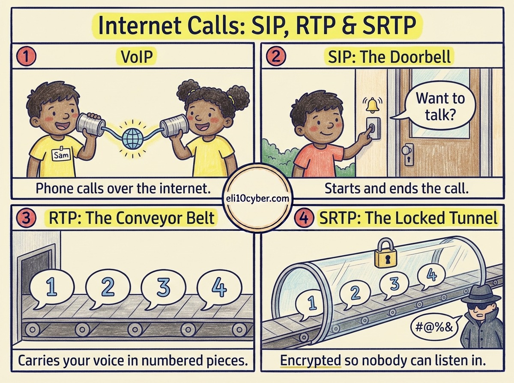

Tap the poster to zoom in.

Like you’re 10

Remember the **tin-can telephone**, two cans joined by a string? **VoIP** is the same idea, except the string is the internet, and your voice is chopped into **tiny pieces** that race across it and get stuck back together on the other side.

Three helpers make it work:

**SIP is the doorbell.** It rings your friend’s phone, asks “Do you want to talk?”, and when you’re done it says goodbye and hangs up.

**RTP is the conveyor belt.** Once you’re talking, it carries the pieces of your voice, each with a **number stamped on it**, so your friend’s phone can put them in the right order.

**SRTP is the conveyor belt inside a locked glass tunnel.** Your voice still travels the same way, but anyone peeking in only sees **scrambled pieces**.

Grown-up version

**VoIP (Voice over IP)** carries voice calls over IP networks instead of traditional phone lines. A call uses two kinds of traffic: **signalling** to set it up, and **media** to carry the sound.

| Protocol | Job | Port | Secure version |
|---|---|---|---|
| **SIP** (Session Initiation Protocol) | Signalling: start, change and end the call | 5060 | SIP over TLS (SIPS), 5061 |
| **RTP** (Real-time Transport Protocol) | Media: carries the audio and video, usually over UDP | Dynamic, agreed during setup | **SRTP** |
| **SRTP** (Secure RTP) | Encrypted, authenticated media with replay protection | Same as RTP | — |

**Two things people get wrong:**

- **RTP doesn’t guarantee delivery or order.** It runs over UDP and stamps each packet with a sequence number and timestamp so the receiver can reorder and time them. Packets that arrive too late are simply dropped, which is better than a delayed conversation.
- **Encrypting SIP alone isn’t enough.** SIPS protects the call setup, but the voice itself is only protected if the media uses SRTP. A secure call needs both.

**Threats to know:** eavesdropping on unencrypted calls, **toll fraud** through hacked phone systems, **caller ID spoofing** behind phone scams (vishing), and denial of service against the phone system.

## A real-world example

In 2023, attackers broke into **3CX**, a company that makes calling software used by hundreds of thousands of businesses. They slipped malware into an official 3CX desktop app update, so customers installed it themselves, trusting it because it came from the real supplier. This kind of attack is called a **supply chain attack**.

Why a buyer cares

- **The risk it reduces:** eavesdropping on sensitive calls, surprise bills from toll fraud, and phone scams that spoof trusted numbers.
- **Who owns it at a company:** the IT or unified communications team, with security involved for regulated industries like finance and healthcare.
- **What gets bought:** cloud calling platforms (Microsoft Teams Phone, Zoom Phone, RingCentral), where encryption comes included, and **session border controllers** (Ribbon, AudioCodes) that act as a firewall for phone traffic.
- **A good discovery question:** *“If someone broke into your phone system this weekend, how would you find out before Monday’s bill?”*

## The one thing to remember

SIP rings the doorbell, RTP carries the voice, and SRTP locks the tunnel. Encrypt both the doorbell and the voice.
